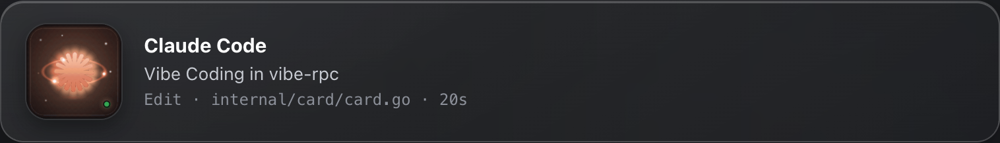
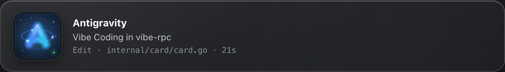
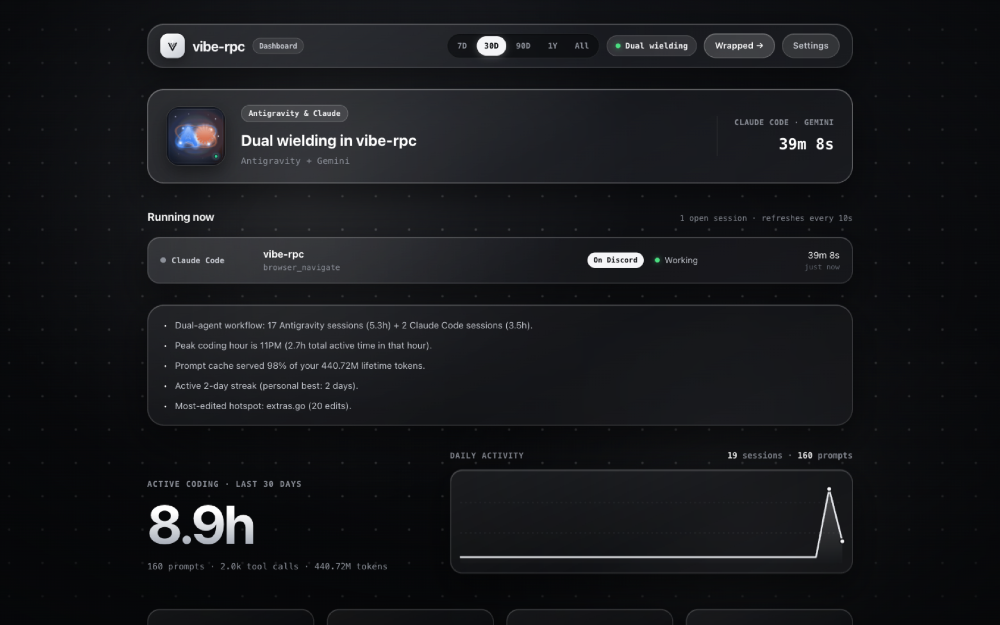
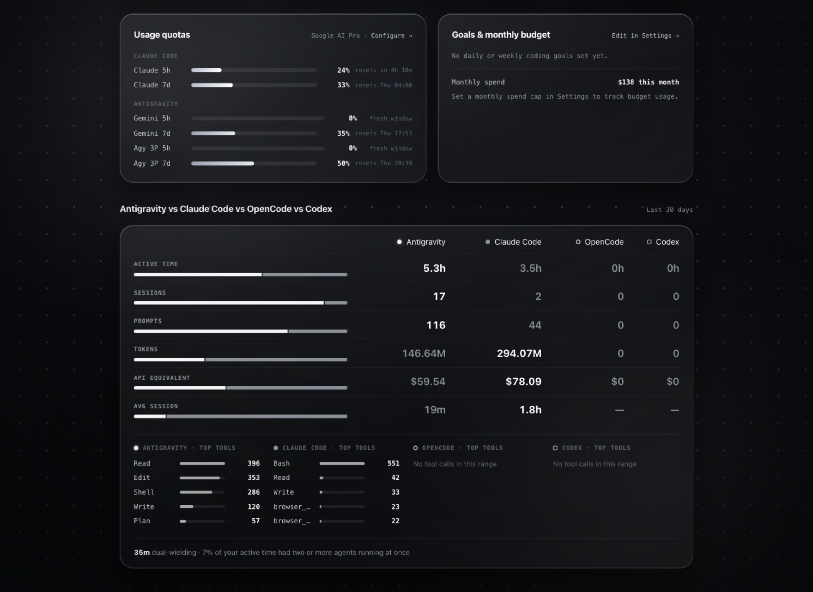
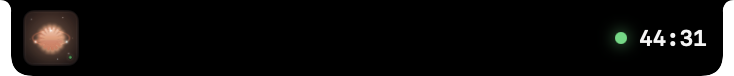
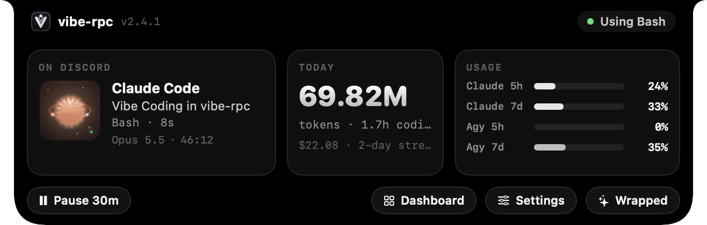
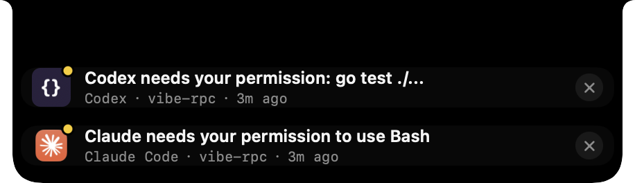
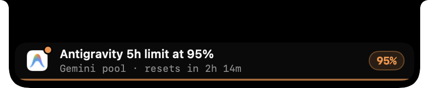

<p align="center"></p>

<h1 align="center">vibe-rpc</h1>

<p align="center">Discord Rich Presence and local coding stats for Antigravity, Claude Code, OpenCode and Codex.</p>

<p align="center">
  <a href="https://github.com/chauveaul/vibe-rpc/actions/workflows/ci.yml"></a>
  <a href="https://github.com/chauveaul/vibe-rpc/releases"></a>
  <a href="./LICENSE"></a>
</p>

vibe-rpc hooks into your coding agents and shows what they are doing on your Discord profile: the project, the current tool and file, and how long the session has run. It also reads your agents' local transcripts to build stats (active time, tokens, API-equivalent cost, streaks, code churn) that you can browse in a terminal UI or a local web dashboard.

It is a single binary for macOS, Linux and Windows.

<p align="center">
  
  
</p>

<p align="center"></p>

## Features

- **Discord Rich Presence** with a card per status (working, thinking, compacting, waiting on you, idle, shipped), animated GIFs, rotating extra lines and optional profile buttons.
- **Per-agent control.** Choose which agents to track, and separately which ones may appear on Discord.
- **Per-repository privacy.** Show a repository in full, by name only, or not at all.
- **Local dashboard** at `http://127.0.0.1:47475` with time ranges, a 12-month heatmap, an agent-by-agent comparison, model cost split, languages and leaderboards.
- **Settings editor** in the browser for card text, GIFs, goals, a monthly budget, a webhook and command triggers. Changes apply without restarting.
- **Terminal UI** (`vibe-rpc`) with seven tabs: Now, Today, Week, Streak, Lifetime, Cost and Code.
- **VibeNotch** (macOS), a status panel in the MacBook notch with usage-limit bars and permission prompts.

<p align="center"></p>

## Requirements

- The Discord desktop app, or Vesktop / arRPC, running on the same machine.
- At least one supported agent: [Antigravity](https://antigravity.google), [Claude Code](https://claude.com/claude-code), [OpenCode](https://opencode.ai) or [Codex CLI](https://developers.openai.com/codex).
- VibeNotch only: macOS 14 or later.

## Install

**Homebrew** (macOS and Linux):

```bash
brew install chauveaul/tap/vibe-rpc
```

**Nix** (flakes):

```bash
nix profile install github:chauveaul/vibe-rpc
```

On NixOS or with Home Manager, add the flake as an input and use its package:

```nix
inputs.vibe-rpc.url = "github:chauveaul/vibe-rpc";

# in your configuration
environment.systemPackages = [ inputs.vibe-rpc.packages.${pkgs.stdenv.hostPlatform.system}.default ];
```

An overlay is also available as `inputs.vibe-rpc.overlays.default`.

**Install script** (macOS and Linux). It downloads the latest release, checks its SHA-256 checksum and installs to `~/.local/bin`:

```bash
curl -fsSL https://raw.githubusercontent.com/chauveaul/vibe-rpc/main/install.sh | sh
```

Set `VIBE_RPC_VERSION=2.4.1` to pin a version, or `VIBE_RPC_INSTALL_DIR=/usr/local/bin` to install somewhere else.

**Windows:** download the `.zip` for your CPU from [Releases](https://github.com/chauveaul/vibe-rpc/releases) and put `vibe-rpc.exe` on your `PATH`.

**From source** (Go 1.26 or later):

```bash
go install github.com/chauveaul/vibe-rpc/cmd/vibe-rpc@latest
```

To update, run `vibe-rpc upgrade`, or use your package manager if you installed with Homebrew or Nix (`nix profile upgrade vibe-rpc`). On macOS and Linux the background daemon notices the new version within a minute and restarts into it, relaunching VibeNotch if it changed.

## Getting started

```bash
vibe-rpc setup
```

Setup lists the agents it finds on your machine and asks which to track. Pass `--agents claude,codex` (or `all`) to skip the question. It then:

1. writes a default config,
2. adds hooks to each agent you picked (Antigravity: `~/.gemini/config/hooks.json`, Claude Code: `~/.claude/settings.json`, Codex: `~/.codex/hooks.json`, OpenCode: a plugin in `~/.config/opencode/plugin/`),
3. registers vibe-rpc to start at login,
4. scans your existing transcripts,
5. starts the background daemon.

Your existing hooks are kept. Codex asks you to trust new hooks the first time it runs them.

Start a session in one of your agents and it appears on your Discord profile. Run `vibe-rpc settings` to customise the card, or `vibe-rpc doctor` if nothing shows up.

## Commands

| Command                                                    | What it does                                                            |
| ---------------------------------------------------------- | ----------------------------------------------------------------------- |
| `vibe-rpc`                                                 | Open the terminal UI                                                    |
| `vibe-rpc setup`                                           | Pick agents, add hooks, scan history and start the daemon               |
| `vibe-rpc serve` / `settings` / `wrapped`                  | Open the dashboard, settings editor or Wrapped in your browser          |
| `vibe-rpc start` / `stop` / `restart` / `logs`             | Control the background daemon                                           |
| `vibe-rpc status [--dump]`                                 | Show the daemon state and the current Discord card                      |
| `vibe-rpc preview`                                         | Render every status card with your current config                       |
| `vibe-rpc vars`                                            | List template variables and their live values                           |
| `vibe-rpc today` / `week` / `projects`                     | Print stats in the terminal                                             |
| `vibe-rpc recap [today\|yesterday\|week\|7d]`              | Print a standup recap (Markdown, or `--json`)                           |
| `vibe-rpc insights`                                        | Print habits such as peak hour and best day                             |
| `vibe-rpc statcards [badge\|card\|calendar\|session-card]` | Render a shareable SVG, or a PNG with `--png`                           |
| `vibe-rpc export [--csv]`                                  | Export your stats as JSON or CSV                                        |
| `vibe-rpc scan [--force]`                                  | Rescan transcripts (incremental by default)                             |
| `vibe-rpc backfill <dir>`                                  | Import transcripts from an archive directory                            |
| `vibe-rpc pause [30m\|2h\|off]`                            | Hide your Discord status for a while                                    |
| `vibe-rpc private [on\|off\|name-only\|status]`            | Set Discord visibility for the current repository                       |
| `vibe-rpc statusline`                                      | Print a one-line status for tmux, shell prompts or agent status bars    |
| `vibe-rpc mcp [install\|uninstall]`                        | Run the MCP server, or register it with Antigravity                     |
| `vibe-rpc notch [on\|off\|install]`                        | Install or toggle VibeNotch (macOS)                                     |
| `vibe-rpc doctor [--fix]`                                  | Check hooks, config, daemon and Discord connection, and repair them     |
| `vibe-rpc upgrade [--check]`                               | Update to the latest release                                            |
| `vibe-rpc uninstall`                                       | Stop the daemon and remove hooks, status lines, MCP entry and autostart |

Run `vibe-rpc <command> --help` for all flags.

## Configuration

Most settings are easiest to change in the browser (`vibe-rpc settings`). They are stored in `config.json`:

| OS      | Config file                                                             |
| ------- | ----------------------------------------------------------------------- |
| macOS   | `~/Library/Application Support/vibe-rpc/config.json`                    |
| Linux   | `$XDG_CONFIG_HOME/vibe-rpc/config.json` (default `~/.config/vibe-rpc/`) |
| Windows | `%APPDATA%\vibe-rpc\config.json`                                        |

Card text uses template variables such as `{project}`, `{currentToolPretty}` or `{tokensLabel}`. Run `vibe-rpc vars` to see all of them with their current values.

Environment variables:

| Variable             | Purpose                                                                                                |
| -------------------- | ------------------------------------------------------------------------------------------------------ |
| `VIBE_RPC_CONFIG`    | Use a different config file                                                                            |
| `VIBE_RPC_DATA_DIR`  | Where stats are stored (default `~/.vibe-rpc`)                                                         |
| `VIBE_RPC_STATE_DIR` | Where the daemon keeps its log and runtime state (default: a `vibe-rpc` folder in the system temp dir) |
| `VIBE_RPC_PORT`      | Port for the local dashboard (default `47475`)                                                         |

### Usage limits

Claude Code and Antigravity CLI only report plan limits to their status line. To see 5-hour and weekly limits in the dashboard and VibeNotch, turn on **Claude Code usage limits** and **Antigravity CLI usage limits** in Settings. vibe-rpc will not replace a custom status line you already have. For Antigravity it is added below the built-in status bar.

### Agent notes

- **OpenCode** history is read with `opencode db`.
- **Codex** history is read from `~/.codex/sessions`. Codex does not record cost, so its API-equivalent cost shows as $0.

## VibeNotch (macOS)

VibeNotch puts a small panel around the MacBook notch. While an agent works, the status GIF and a session timer sit on either side of the notch:

<p align="center"></p>

Hover below the notch to see your Discord card, today's stats, usage bars and buttons for pause, dashboard, settings and Wrapped:

<p align="center"></p>

When an agent asks for permission or asks you a question, the panel drops down with one row per agent. Clicking a row takes you to that agent's terminal or editor:

<p align="center"></p>

It also warns you when a plan limit reaches 90 %, 95 % and 100 %:

<p align="center"></p>

```bash
vibe-rpc notch install   # download VibeNotch.app into ~/Applications
vibe-rpc notch           # turn it on
vibe-rpc notch off       # turn it off
```

With Homebrew, VibeNotch is installed with vibe-rpc and `brew upgrade` updates both; you don't need `notch install`. Other installs keep VibeNotch in `~/Applications`, and `vibe-rpc upgrade` updates it along with the binary.

The daemon keeps it running across logins. It needs no Accessibility or Screen Recording permission, and on Macs without a notch it sits at the top centre of the screen. To build it yourself (requires Xcode): `macos/VibeNotch/build-app.sh --install`.

## Privacy

Your stats stay on your machine, in `~/.vibe-rpc`. vibe-rpc talks to Discord through the desktop app's local IPC socket. It only makes network requests when you run `upgrade` or `notch install` (both call the GitHub API) or when you set a webhook in Settings.

Discord shows what your card templates contain. To keep a repository off your profile, run `vibe-rpc private on` inside it, or set it to Hidden or Name only under **Settings → Workspace privacy**. To keep an agent off Discord while still tracking it, turn off its **Show on Discord** switch under **Settings → Agents**.

## Uninstall

```bash
vibe-rpc uninstall
```

This stops the daemon and removes the hooks, status lines, MCP entry and login autostart. It leaves your stats and config in place; delete `~/.vibe-rpc` and the config folder above to remove them, then remove the binary with whatever installed it (`brew uninstall vibe-rpc` or `nix profile remove vibe-rpc`).

## Contributing

Bug reports and pull requests are welcome. For larger changes, please open an issue first so we can agree on the approach.

```bash
git clone https://github.com/chauveaul/vibe-rpc.git
cd vibe-rpc
go build ./cmd/vibe-rpc
go vet ./...
go test ./...
```

CI runs `go vet` and `go test` on Linux and macOS, and cross-compiles every release target (macOS, Linux and Windows on amd64 and arm64). Please run `gofmt` on changed files and add tests for new behaviour. CI also builds the Nix package; if you change `go.sum`, update `vendorHash` in `nix/package.nix` (the failing build prints the new value).

Where things live:

| Path                                                       | Contents                                                          |
| ---------------------------------------------------------- | ----------------------------------------------------------------- |
| `cmd/vibe-rpc`                                             | CLI entry point and commands                                      |
| `internal/daemon`, `internal/discord`, `internal/presence` | Background daemon, Discord IPC and card selection                 |
| `internal/hook`, `internal/install`                        | Agent hook handler and hook installation                          |
| `internal/scanner`, `internal/stats`, `internal/pricing`   | Transcript parsing, aggregation and cost estimates                |
| `internal/server`                                          | Web dashboard, settings and Wrapped (HTML templates in `assets/`) |
| `internal/tui`                                             | Terminal UI                                                       |
| `internal/card`                                            | PNG card rendering                                                |
| `macos/VibeNotch`                                          | SwiftUI notch app                                                 |
| `nix/package.nix`, `flake.nix`                             | Nix package                                                       |
| `scripts/`                                                 | Homebrew formula and AUR package generators                       |

## License

[MIT](./LICENSE)
