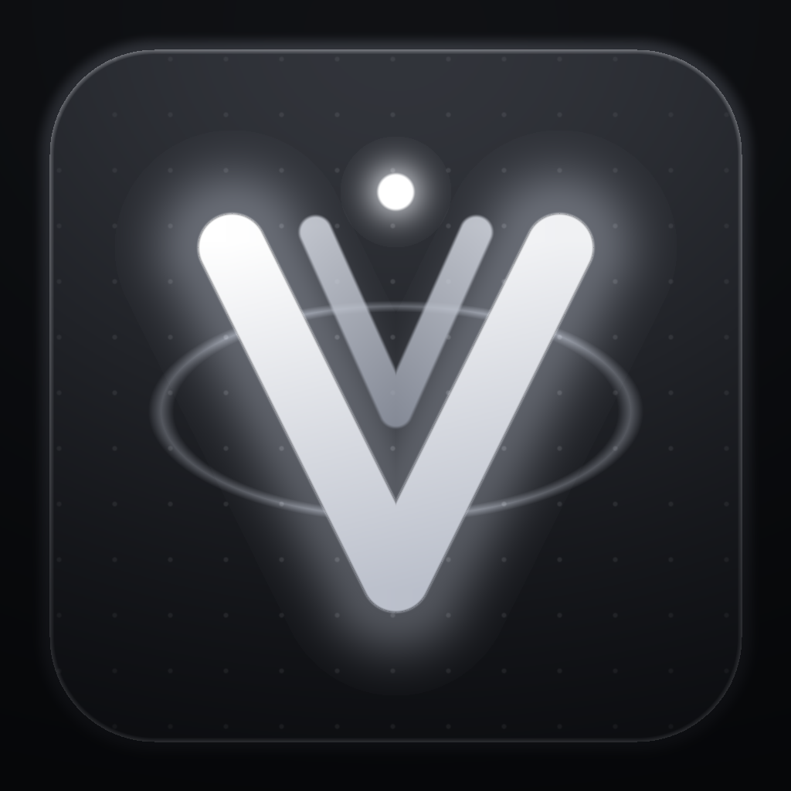

<p align="center"></p>

<h1 align="center">vibe-rpc</h1>

<p align="center">Discord Rich Presence + coding analytics for <b>Google Antigravity</b> and <b>Claude Code</b>.</p>

**100% Pure Go** Discord Rich Presence, live status tracking, and coding analytics for **Google Antigravity** and **Claude Code** — combined into one single native binary with **zero JavaScript/TypeScript** anywhere (even the local web dashboard, settings editor, and Wrapped story are pure Go SSR HTML + CSS).

Built to match the functionality, paper-and-ink aesthetic, customizability, and Discord Rich Presence card feel of `claude-rpc` while unifying **both Antigravity and Claude Code**.

## Features

- **Combined Dual-Agent Tracking**
  - Hooks into **Antigravity** (`~/.gemini/config/hooks.json`, strictly obeying the fail-closed `PreToolUse` `{"decision":"allow"}` contract) and **Claude Code** (`~/.claude/settings.json`, `{"continue":true}`).
  - Passively merges live sessions from `$TMPDIR/claude-rpc` and scans transcripts from both `~/.gemini/{antigravity,antigravity-cli,antigravity-ide}/brain/` and `~/.claude/projects/`.
  - Dynamically switches your Discord card's app title between **`Antigravity`** and **`Claude Code`** depending on which agent is active (configurable).
- **Exact Discord Rich Presence Integration**
  - Direct raw binary Discord IPC protocol (macOS/Linux Unix sockets + Windows Named Pipes) with automatic arRPC / Vesktop bridge detection, keepalive, sliding-window rate throttling (4 writes / 20s), exponential reconnect backoff, animated GIF status assets, conditional rotation frames, multi-session party counts, and automatic public GitHub repo buttons.
- **Zero-JS Local Web Suite** (`http://127.0.0.1:47475`)
  - `/` — Editorial paper-and-ink dashboard with time ranges (`7d`/`30d`/`90d`/`1y`/`all`), live Discord preview rail, pure Go SVG activity & code churn charts, clickable 90-day heatmap day modal, project breakdown drawer, model cost split, language stack, achievements, and leaderboards.
  - `/settings` — Full visual settings editor for every status (`working`, `thinking`, `compacting`, `shipped`, `notification`, `idle`), live preview, extra rotation frames, custom buttons, source toggles, daemon start/stop/restart + log viewer, and per-workspace privacy (`Public` / `Name only` / `Hidden`).
  - `/wrapped` — Full-screen pure CSS animated Coding Wrapped story slides.
- **Interactive Terminal Dashboard (`vibe-rpc`)**
  - Built with `bubbletea` + `lipgloss`: 7 tabs (`Now`, `Today`, `Week`, `Streak`, `Lifetime`, `Cost`, `Code`), live 3-second refresh, keyboard navigation.
- **Built-in MCP Server (`vibe-rpc mcp`)**
  - Exposes `get_lifetime_stats`, `get_today`, `get_top_files`, `get_model_split`, and `get_recap` over stdio JSON-RPC; register globally with `vibe-rpc mcp install`.
- **Shareable SVG Stat Cards & Exports**
  - `vibe-rpc badge`, `vibe-rpc card`, `vibe-rpc calendar`, `vibe-rpc session-card`, `vibe-rpc export --csv`, `vibe-rpc recap`, `vibe-rpc statusline`.

## Install

**Homebrew** (macOS and Linux):

```bash
brew install chauveaul/tap/vibe-rpc
```

**Install script** (macOS and Linux). It downloads the latest release, verifies its SHA-256 checksum, and installs to `~/.local/bin`:

```bash
curl -fsSL https://raw.githubusercontent.com/chauveaul/vibe-rpc/main/install.sh | sh
```

Set `VIBE_RPC_VERSION=2.1.0` to pin a version or `VIBE_RPC_INSTALL_DIR=/usr/local/bin` to change where it goes.

**Windows:** download the `.zip` for your CPU from [Releases](https://github.com/chauveaul/vibe-rpc/releases) and put `vibe-rpc.exe` on your `PATH`.

Then run one-time setup:

```bash
vibe-rpc setup
```

This seeds your config, wires Antigravity & Claude Code hooks, runs an in-process hook self-test, installs OS login autostart, scans your transcript history, and starts the background daemon.

### Updating

```bash
vibe-rpc upgrade          # install the latest release (restarts the daemon)
vibe-rpc upgrade --check  # just check
```

Homebrew installs update with `brew upgrade vibe-rpc` instead.

### Build from source

Requires Go 1.26+.

```bash
go build -o vibe-rpc ./cmd/vibe-rpc
# or install into your $GOPATH/bin:
go install ./cmd/vibe-rpc
```

### Releasing (maintainers)

Push a version tag and GitHub Actions does the rest (tests, GoReleaser builds for macOS universal / Linux / Windows on amd64 + arm64, checksums, GitHub release, Homebrew tap formula):

```bash
git tag v2.1.0 && git push origin v2.1.0
```

Dry run locally with `goreleaser release --snapshot --clean`.

## OpenCode

vibe-rpc also tracks [OpenCode](https://opencode.ai) sessions. `vibe-rpc setup` installs a small plugin at `~/.config/opencode/plugin/vibe-rpc.js` that forwards OpenCode's events (prompts, tool calls, permission prompts, idle) to vibe-rpc, so OpenCode shows on Discord, in the dashboard's running sessions and in VibeNotch's alerts. History (tokens, cost, active time, tools) is read from OpenCode's database with `opencode db`, so nothing extra is needed. Skip it with `vibe-rpc setup --no-opencode` or untick **Track OpenCode** in Settings.

## VibeNotch (macOS)

A live status panel that lives in your MacBook's notch. While Antigravity or Claude Code is working, small "live activity" ears appear beside the notch: the status GIF on the left and a session timer on the right. Hover under the notch to expand it into your live Discord card, today's hours and goal, usage bars, and buttons for Pause 30m, Dashboard, Settings and Wrapped.

When Claude Code or Antigravity needs a permission or asks you a question, the notch drops down to show the prompt (one row per agent, so it goes lower when both need you) instead of a desktop notification. An alert disappears once you switch to the terminal or editor that agent runs in; clicking it takes you there.

The usage bars show real 5-hour session and weekly plan limits (with reset times) for both **Claude Code** (Pro, Max and Ultra) and **Antigravity CLI** (auto-switching between your Gemini and 3P pools based on the active model). Both CLIs share quotas only with their status line, so turn on **Claude Code usage limits** and/or **Antigravity CLI usage limits** in Settings (neither replaces an existing custom status line, and Antigravity stacks `vibe-rpc statusline` beneath its built-in bar). Until Antigravity limits are enabled, its bar falls back to active time in the rolling 5-hour window.

```bash
macos/VibeNotch/build-app.sh --install   # builds VibeNotch.app into ~/Applications (needs Xcode)
vibe-rpc notch                           # turn it on (or use the switch in Settings)
vibe-rpc notch off                       # turn it off
```

While it's on, the daemon keeps it running, so it comes back at login. Right-click the notch for **Settings…** or **Turn Off VibeNotch**. It needs no Accessibility or Screen Recording permissions, only takes clicks while it's open, and works on Macs without a notch (it sits at the top center of the screen).

## Commands

| Command | Description |
| --- | --- |
| `vibe-rpc` | Launch the 7-tab Bubbletea TUI dashboard |
| `vibe-rpc setup` | Wire hooks, seed config, scan transcripts, start daemon |
| `vibe-rpc settings` | Open the zero-JS Settings editor (`:47475/settings`) |
| `vibe-rpc serve` | Open the zero-JS Web Dashboard (`:47475/`) |
| `vibe-rpc wrapped` | Open your Coding Wrapped story (`:47475/wrapped`) |
| `vibe-rpc status [--dump]` | Show daemon status & Discord preview |
| `vibe-rpc today` / `week` / `projects` | Terminal analytics summaries |
| `vibe-rpc recap [range]` | Standup-ready coding recap (`today`, `yesterday`, `week`, `7d`) |
| `vibe-rpc insights` | Habit & dual-agent insights |
| `vibe-rpc doctor [--fix]` | Diagnose and repair hooks, daemon, Discord IPC, and caches |
| `vibe-rpc scan [--force]` | Incremental or full transcript rescan |
| `vibe-rpc pause [30m\|2h\|off]` | Temporarily hide Discord Rich Presence |
| `vibe-rpc private [on\|off\|name-only]` | Control repo visibility on Discord |
| `vibe-rpc statcards [badge\|card\|calendar\|session-card]` | Render shareable SVGs |
| `vibe-rpc mcp [install\|uninstall]` | Stdio MCP server / Antigravity registration |
| `vibe-rpc start\|stop\|restart\|logs` | Daemon controls |
| `vibe-rpc upgrade [--check]` | Update to the latest GitHub release |
| `vibe-rpc notch [on\|off]` | Turn VibeNotch, the live status panel in the MacBook notch, on or off (macOS) |
| `vibe-rpc uninstall` | Remove hooks, MCP config, autostart, and stop daemon |

## Key Go Libraries

- [`github.com/spf13/cobra`](https://github.com/spf13/cobra) — CLI commands & shell completions
- [`github.com/charmbracelet/bubbletea`](https://github.com/charmbracelet/bubbletea) & [`lipgloss`](https://github.com/charmbracelet/lipgloss) — Interactive TUI
- [`github.com/fsnotify/fsnotify`](https://github.com/fsnotify/fsnotify) — Real-time state/config file watching
- [`github.com/shirou/gopsutil/v4`](https://github.com/shirou/gopsutil/v4) — Cross-platform process detection (Antigravity + Claude Code)
- [`github.com/google/uuid`](https://github.com/google/uuid) — Discord IPC frame nonces

## License

MIT — see [LICENSE](./LICENSE).
